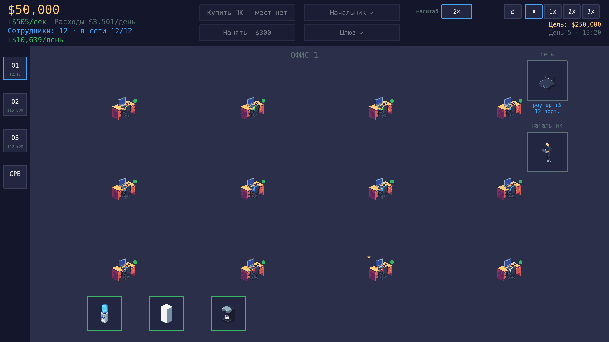

# IT Director

A pixel-art browser clicker about growing an IT company, inspired by Intel's
*IT Manager 3: Unseen Forces* (not affiliated with or endorsed by Intel).
Buy PCs, hire staff, build the network (routers → core switch → server racks
→ internet gateway), open new offices and keep income ahead of payroll and
running costs. Sink deeper than a day's expenses (the credit line on the hard
levels) at the end-of-day settlement and the company goes bankrupt. The
game's UI is Russian-only (as are code comments and docs in this repo).

Play: https://itgame.santarinto.ru

## Tech stack

- **Server:** Go — one game actor per WebSocket connection, file-based
  session saves with reconnect and offline catch-up.
- **Client:** Phaser 3, TypeScript, Vite.
- **Protocol:** JSON over WebSocket.
- **Database:** PostgreSQL, optional (used only by the `/admin` page).

## Getting started

Requires Go 1.26 and Node.js 22. UI tests (`smoke-ui`, `qa:*`, `visreg`) run
a pinned Chrome for Testing: `cd client && npm run browser:install` (see
[docs/development.md](docs/development.md#tests); `CHROME_PATH` overrides).

    make dev        # Go server :8080 + Vite :5173 → http://localhost:5173
    make build      # then: ./bin/itdirector -static client/dist
    make test       # Go tests (DB tests need TEST_DATABASE_URL)
    make typecheck  # client type check
    make smoke-ui   # headless-browser smoke test of the built client

To enable `/admin`, put `DATABASE_URL=postgres://…` into `.env` in the repo
root. The header link is hidden from players: open `/?admin=1` once
(remembered in localStorage, `?admin=0` hides it again) or use `?debug=1`.

Deploy, saves, testing, CI and the asset pipeline:
[`docs/development.md`](docs/development.md).

## Credits

- Palette: [Sweetie 16](https://lospec.com/palette-list/sweetie-16) by GrafxKid.
- Sprites: generated with [PixelLab](https://www.pixellab.ai), post-processed
  by the scripts in `scripts/sprites/`.
- Sound effects: [Kenney Interface Sounds](https://kenney.nl/assets/interface-sounds) (CC0).
- Font: [Departure Mono](https://github.com/rektdeckard/departure-mono) 1.500
  by Helena Zhang (SIL OFL 1.1).
- Symbol font «ITD Symbols»: an 8-glyph subset (⌂⏸▶☣✓✕✖✗) of
  [GNU Unifont](https://unifoundry.com/unifont/) 16.0.04 by Roman Czyborra,
  Paul Hardy et al., used under the SIL OFL 1.1 of its dual license; rebuilt by
  `client/scripts/font-symbols.py`. License texts:
  `client/public/assets/fonts/OFL-*.txt`.

`ITGAME-N` references in the code and docs are ticket numbers from an
internal development tracker, not a public issue tracker.

## License

Copyright (C) 2026 santarinto.

[GNU Affero General Public License v3.0 or later](LICENSE).
